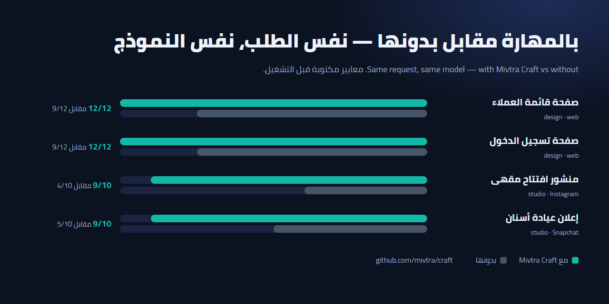

# Mivtra Craft — مهاراة ميفترا

Arabic-first skills for building complete products with Claude: WPF desktop and web
(PHP / ASP.NET Core), one design identity with RTL and light + dark themes, sound code and
security rules, and Arabic social content.

مهارات تبني مع Claude برامج عربية كاملة: سطح المكتب والويب، هوية تصميم واحدة باتجاه من
اليمين وثيم فاتح وداكن، قواعد كود وأمان، ومحتوى عربي للتواصل الاجتماعي.




Tested, not promised: every skill ran on real requests with and without it, scored against checks
written before the run. اختبرنا كل مهارة بطلبات حقيقية بها وبدونها، بمعايير كُتبت قبل التشغيل.

## Try it in two minutes — جرّبها في دقيقتين

After installing, paste one of these into Claude — بعد التثبيت الصق أحدها في Claude:

```text
صمم صفحة HTML و CSS واحدة لقائمة العملاء في نظام عربي (جدول، بحث، زر إضافة).
```

```text
منشور انستغرام لافتتاح مقهى «ركن الهيل» في الملقا بالرياض يوم الخميس. الجمهور: شباب وعائلات.
اللهجة: نجدية بيضاء. العرض: قهوة مجانية لأول 100 زائر. أريد النص وفكرة التصميم.
```

```text
أنشئ صفحة تسجيل دخول لتطبيق ويب PHP 8 بدون إطار عمل، مع MySQL عبر PDO. الدخول باسم المستخدم أو البريد.
```

## Install — التثبيت

### Windows — one command · أمر واحد

Open **PowerShell** (not Claude) and run — افتح PowerShell وشغّل:

```powershell
irm https://raw.githubusercontent.com/mivtra/craft/main/install.ps1 | iex
```

It installs directly — nothing to upload: the `mivtra-craft` plugin in Claude Code (CLI, VS Code,
JetBrains, or the Code tab of the Claude desktop app), or personal skills in `~/.claude/skills`
when Claude Code is not found. Run the same command again to update.

يثبّت مباشرة دون أي رفع يدوي: الإضافة داخل Claude Code (سطر الأوامر، أو VS Code، أو تبويب Code في
تطبيق Claude)، أو مهارات شخصية في `~/.claude/skills` إن لم يجد Claude Code. أعد تشغيله للتحديث.

Remove — الإزالة:

```powershell
& ([scriptblock]::Create((irm https://raw.githubusercontent.com/mivtra/craft/main/install.ps1))) -Uninstall
```

### claude.ai chat · محادثة claude.ai

Chat skills live in your Claude account, and no command can add them there — this is the one
manual step. Download **[mivtra-craft.zip](https://github.com/mivtra/craft/releases/latest/download/mivtra-craft.zip)**,
then **Settings → Plugins → Upload**.

مهارات المحادثة تُحفظ في حسابك، ولا يستطيع أي أمر إضافتها إليه؛ هذه الخطوة اليدوية الوحيدة.
حمّل الملف ثم الإعدادات ← الإضافات ← رفع.

### Claude Code — inside Claude · داخل Claude Code

```
/plugin marketplace add mivtra/craft
/plugin install mivtra-craft@mivtra
```

These two are typed in Claude Code, not in PowerShell. هذان الأمران يُكتبان داخل Claude Code لا في PowerShell.

## Free core — النسخة المجانية (MIT)

| Skill | Use |
|---|---|
| `mivtra-craft:code` | Entry point: routes the request, code and security rules · المدخل وقواعد الكود والأمان |
| `mivtra-craft:design` | Visual identity, RTL, light + dark, screens · التصميم والاتجاه والثيمان |
| `mivtra-craft:studio` | Arabic posts, ads, designs, short video · منشورات وإعلانات وتصاميم وفيديو عربي |

## Mivtra Craft Pro — الحزمة الكاملة

Adds `product` (plan and project memory, About + licensing, backups, demo data, login and
roles, installer, signed updates, printing, packaging), `audit`, `api`, `tests`, `office` and
`it`. **[Get Mivtra Craft Pro — $39](https://mivtra.gumroad.com/l/mivtra-craft-pro)** · launch code `LAUNCH30` (30% off, first 50 buyers).

تضيف طبقة المنتج كاملة والتحديثات الموقّعة والطباعة والفحص والاختبارات وملفات الأوفيس. **[اشترِ الحزمة الكاملة](https://mivtra.gumroad.com/l/mivtra-craft-pro)** · كود الإطلاق `LAUNCH30` خصم 30% لأول 50 مشترياً.

## First step — أول خطوة

On the first product Claude asks for your brand (name, e-mail, site, logo, licensing) and saves
it in `~/.claude/mivtra-craft/brand.md`; a project can override it in `docs/brand.md`.

في أول برنامج يسألك Claude عن بيانات علامتك ويحفظها في `~/.claude/mivtra-craft/brand.md`،
ويمكن لكل مشروع أن يغيّرها في `docs/brand.md`.

Licence: MIT (`LICENSE`). Third-party parts: `THIRD-PARTY-NOTICES.md`.
